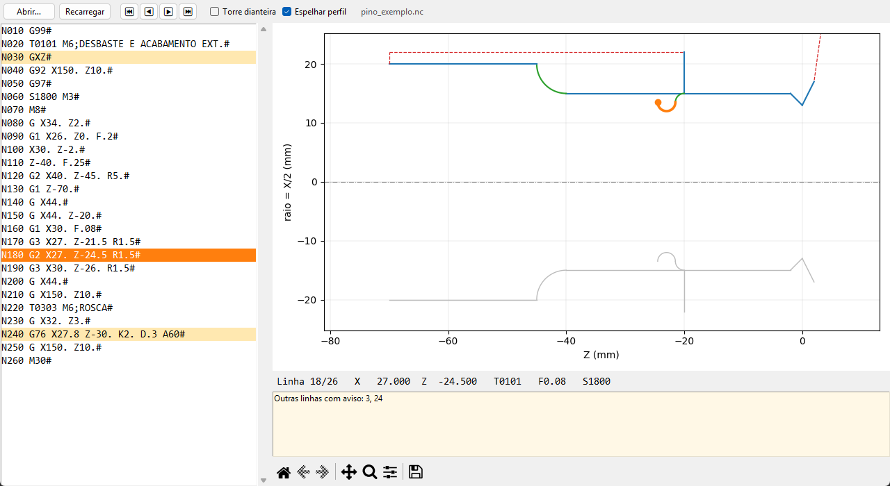

# Simulador de Torno MACH

Simulador gráfico (backplot) para programas de torno CNC no dialeto **MACH8/MACH9**
(comandos Romi/MCS). Abre o programa, mostra o caminho da ponta da ferramenta e o perfil da
peça, e deixa avançar **linha a linha** vendo posição, ferramenta, avanço e rotação.

Feito porque simuladores ISO genéricos interpretam errado o dialeto MACH:

| Código | MACH | ISO genérico |
|---|---|---|
| `G20` / `G21` | X em diâmetro / X em raio | polegada / milímetro |
| `G` sem número | `G0` | — |
| eixo sem valor (`GXZ`, `Z#`) | vale zero | erro |
| `I` / `K` | centro do arco em coordenada **absoluta** (I em diâmetro) | incremental |
| `G2` / `G3` | sentido depende da torre (traseira/dianteira) | fixo |
| `G99` | cancela `G92` (zero-máquina) | avanço por rotação |



## Uso

```
pip install -r requirements.txt
python simulador.py [programa.nc | programa.txt | programa.docx]
```

- **↓ / →** próxima linha, **↑ / ←** anterior, **Home / End** início/fim; clicar numa linha pula
  até ela. A barra do matplotlib dá zoom/pan, e o zoom é mantido ao avançar.
- **Torre dianteira**: inverte o sentido de `G2`/`G3` (padrão: torre traseira, `G2` = horário).
- **Espelhar perfil**: repete o corte abaixo da linha de centro para ver a silhueta da peça.
- Lê `.docx` direto (texto dos parágrafos; títulos sem código viram comentário).

Linhas com aviso ficam destacadas em amarelo. Os avisos cobrem erros de digitação que o
comando rejeitaria (`G0.20` no lugar de `F0.20`, `X19. 0`, vírgula decimal, ponto duplo),
arcos geometricamente impossíveis (`G02/G03 - DEF.ILEGAL`, como no comando), `G1` sem avanço,
e placeholders de ferramenta (`T0?0?`).

## O que não é simulado

Viram aviso e **não são desenhados** — o simulador não tenta adivinhar a geometria:

- ciclos automáticos: `G33`, `G37`, `G66`, `G67`, `G68`, `G73`, `G74`, `G75`, `G76`, `G83`;
- compensação de raio da ponta (`G41`/`G42`) — o desenho é o da ponta teórica;
- subprogramas (`P`/`L`) e desvios (`H`).

`GXZ` fora de `G92` é tratado como ida ao zero-máquina: a posição em relação à peça fica
desconhecida até o próximo `G92 X.. Z..`, e esse deslocamento não é desenhado.

## Estrutura

- `mach_parser.py` — leitura de blocos (tokens, comentários `;` e `( )`, fim de bloco `#`, `.docx`).
- `mach_sim.py` — máquina de estados: modos, `G92`/`G99`, `G20`/`G21`, `G90`/`G91`, `U`/`W`,
  arcos por `R` ou `I`/`K`; gera os segmentos e os avisos por linha.
- `desenho.py` — desenho com matplotlib.
- `simulador.py` — interface tkinter.
- `test_mach.py` — testes (`python -m unittest -v`).

## Gerar o .exe

```
pyinstaller --noconsole --onedir --name "Simulador Torno MACH" simulador.py
```

Referência: *Manual de Programação e Operação MACH9* (Romi, R69001C).
